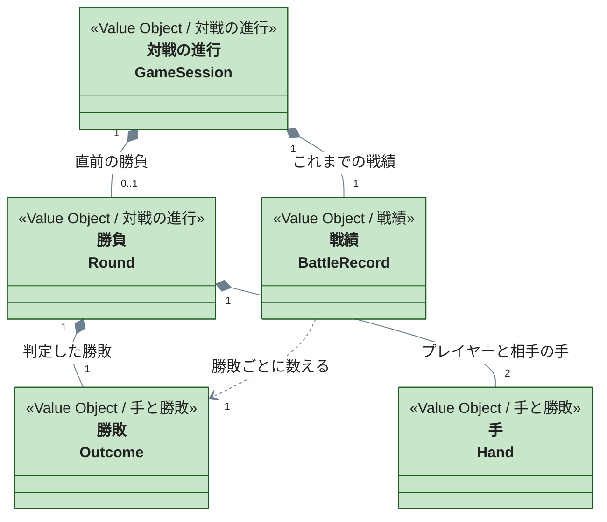

# janken パッケージ

じゃんけんの手・勝敗判定・戦績・対戦の進行を表すパッケージです。コードは `packages/janken/src/domain/` にあります。

## 境界一覧

| 境界 | コードのフォルダ | 内容 |
| --- | --- | --- |
| [手と勝敗](hand-手と勝敗.md) | `hand/` | 手と、2 つの手から決まる勝敗 |
| [戦績](battle-record-戦績.md) | `battle-record/` | 勝ち・負け・あいこの回数と割合 |
| [対戦の進行](game-session-対戦の進行.md) | `game-session/` | 直前の勝負と戦績から、次に何ができるかを決める |

## 俯瞰図

対戦の進行は、直前の勝負と戦績を 1 つにまとめた値です。プレイヤーが手を選ぶたびに、新しい勝負を判定して戦績に加えた新しい対戦の進行が作られます。相手の手をランダムに選ぶ部分（乱数）はドメインの外にあり、ドメインは「0 以上 1 未満の値をどの手に対応させるか」（等確率の規則）だけを持ちます。
