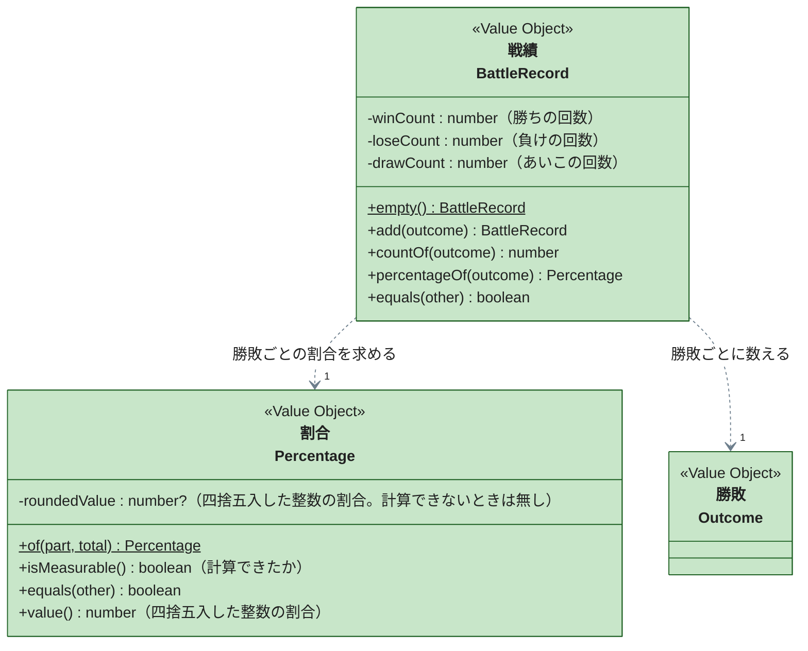

# 戦績（battle-record）

勝ち・負け・あいこの回数と、それぞれの割合を表す境界です。コードは `packages/janken/src/domain/battle-record/` にあります。

`Outcome` は [手と勝敗](hand-手と勝敗.md) の境界のクラスです。各関数の仕様（四捨五入の境界値・合計が 0 のとき・拒否条件）は `BattleRecord.test.ts` と `Percentage.test.ts` の `describe` を参照してください。

---

## 戦績（BattleRecord）

ページを開いてからの勝ち・負け・あいこの回数を持ち、勝敗ごとの割合を求めます。`add` は回数を 1 増やした新しい戦績を返し、自分自身は変えません。

- **割合の分母を戦績が決める。** 分母は勝ち・負け・あいこの合計（[UC-01](../../usecases/UC-01-じゃんけんで対戦する.md)）。分母の選び方は業務の判断なので、表示側で回数から割り算させず、戦績が割合を返す
- **Entity にしなかった。** 戦績は保存せず、再読み込みで捨てる。後から同じものとして取り出すライフサイクルが無いため、値で比較できる Value Object にした
- **回数を勝敗の種類ごとの getter で公開しなかった。** `countOf(outcome)` に勝敗を渡して聞く形にし、勝敗の種類を呼び出し側で分岐させない

---

## 割合（Percentage）

ある回数が合計に占める割合を、小数第 1 位を四捨五入した整数のパーセンテージで表します。

- **「計算できない」を値として持つ。** 合計が 0 のとき割合は存在しない。0% に寄せると「全部負けた」と区別できなくなるため、`isMeasurable()` が偽の値として表し、表示側が「-」を出す（[UC-01](../../usecases/UC-01-じゃんけんで対戦する.md) の要件 13）
- **四捨五入の規則をここに閉じた。** 丸め方を表示側に書くと、表示箇所ごとに丸めが揺れるため
- `value()` は表示用の DTO へ変換するための getter で、計算できない割合に対しては使えない
