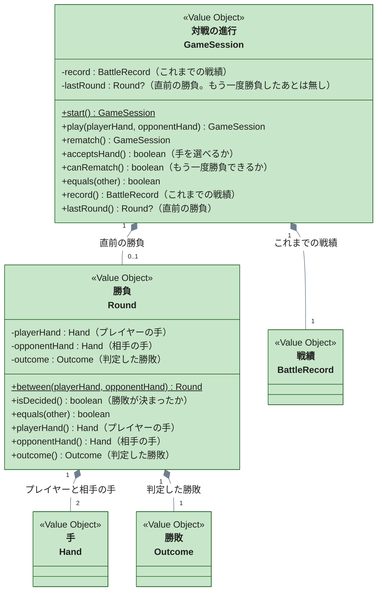

# 対戦の進行（game-session）

直前の勝負と戦績から、いま手を選べるか・もう一度勝負できるかを決める境界です。コードは `packages/janken/src/domain/game-session/` にあります。

`BattleRecord` は [戦績](battle-record-戦績.md)、`Hand` と `Outcome` は [手と勝敗](hand-手と勝敗.md) の境界のクラスです。各関数の仕様（どの状態で手を受け付けるか・拒否条件）は `GameSession.test.ts` と `Round.test.ts` の `describe` を参照してください。

---

## 対戦の進行（GameSession）

ページを開いている間の対戦の状態です。画面の 3 つの状態（手の選択・あいこ・結果）は、直前の勝負から導きます。直前の勝負が無いか、あいこなら手を選べ、勝敗が決まっていればもう一度勝負できます。

- **状態遷移をモデルに置いた。** 「結果を表示している間は新しい勝負を受け付けない」（[UC-01](../../usecases/UC-01-じゃんけんで対戦する.md) の要件 15）は業務の規則なので、手のボタンを隠す画面側ではなく `play` が拒否する。画面側だけで守ると、ボタン以外の経路から勝負が進んだときに戦績と表示が食い違う
- **画面の状態（手の選択・あいこ・結果）を別の値として持たなかった。** 状態は直前の勝負から一意に決まる。別に持つと、直前の勝負と状態が食い違う組み合わせを作れてしまう
- **相手の手を引数で受け取る。** 相手の手をどう選ぶか（乱数）は外部の都合なので、ここでは選ばれた手を受け取るだけにする
- **Entity にしなかった。** 保存せず再読み込みで捨てるため、戦績と同じく Value Object にした。`play` と `rematch` は新しい対戦の進行を返す
- `record()` と `lastRound()` は表示用の DTO へ変換するための getter で、条件判定には `acceptsHand()` と `canRematch()` を使う

---

## 勝負（Round）

プレイヤーの手と相手の手、そこから判定した勝敗の 1 回分です。`between` で 2 つの手から勝敗を判定して作ります。

- **勝敗を作るときに確定させて持つ。** 2 つの手から毎回判定し直せるが、表示や戦績が同じ勝負について別々に判定すると、判定の場所が増える。作るときに 1 回だけ判定して持つ
- getter は表示用の DTO へ変換するためのもので、条件判定には `isDecided()` を使う
