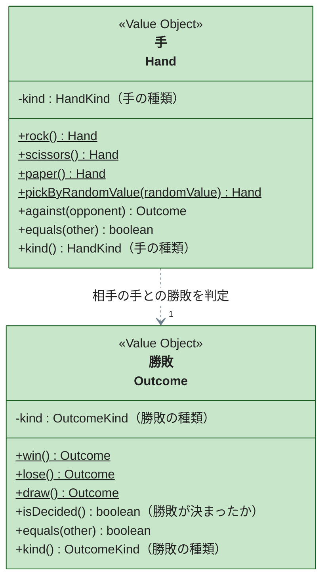

# 手と勝敗（hand）

プレイヤーと相手が出す手と、2 つの手から決まる勝敗を表す境界です。コードは `packages/janken/src/domain/hand/` にあります。

各関数の仕様（条件ごとの結果・拒否条件）は `Hand.test.ts` と `Outcome.test.ts` の `describe` を参照してください。

---

## 手（Hand）

プレイヤーと相手が出すグー・チョキ・パーを表します。勝敗の規則（グーはチョキに勝つ、など）を持つのはこのクラスだけで、`against` で相手の手との勝敗を返します。

- **等確率の規則を `pickByRandomValue` に置いた。** 相手の手を「等しい確率で選ぶ」ことは業務の規則なので、ドメインに置く。ただし乱数の生成はドメインの外（相手の手を選ぶ port の実装）に置き、ドメインは「0 以上 1 未満の値を 3 等分してどの手に対応させるか」だけを持つ。乱数をドメインで呼ぶと、単体テストで結果を固定できず、等確率の規則を検証できなくなるため
- **乱数値を Value Object にしなかった。** 乱数値はドメインの概念ではなく、外から入る入力にすぎない。primitive の number で受け、値の範囲の検証は factory に置く
- **勝敗の判定を Domain Service にしなかった。** 判定に要るのは 2 つの手だけで、手自身が「自分は何に勝つか」を知っていれば足りる。Tell, Don't Ask に従い、手の種類を外で取り出して比べる書き方をさせない
- `kind()` は表示用の DTO へ変換するための getter で、条件判定には使わない

---

## 勝敗（Outcome）

1 回の勝負をプレイヤーから見た結果（勝ち・負け・あいこ）を表します。

- **`isDecided` を持たせた。** 「勝敗が決まったか（あいこでないか）」は、もう一度勝負するボタンを出すか・手のボタンを出したままにするかの分かれ目で、複数の場所が使う判断になる。呼び出し側で「あいこと等しくないか」を組み立てさせず、勝敗自身に答えさせる
- `kind()` は表示用の DTO へ変換するための getter で、条件判定には使わない
