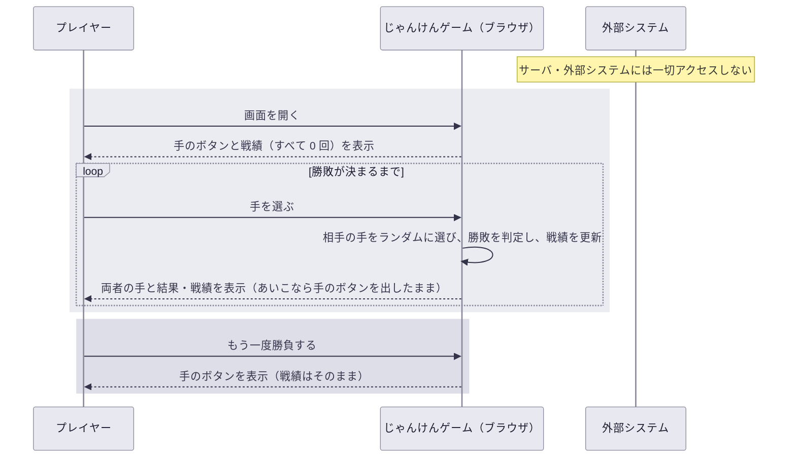

# UC-01 じゃんけんで対戦する

## 概要

| 項目 | 内容 |
| --- | --- |
| アクター | プレイヤー（ブラウザでページを開いた 1 人） |
| 目的 | コンピュータとじゃんけんをし、勝敗と戦績を見ながら何度でも遊ぶ |
| きっかけ | プレイヤーがじゃんけん画面を開く |
| 事前条件 | なし（ログイン・事前のデータは不要） |
| 要求の経緯 | [.designs/REQ-001-janken](../../.designs/REQ-001-janken/request.md) |

用語（手・勝敗・あいこ・戦績）の定義は [ユビキタス言語](../domain/ubiquitous-language.md) にあります。

## 動作の全体像

## 正常系の動き

1. プレイヤーが画面を開くと、手のボタンと戦績が表示される
   - **UC-01 要件 1**（未実装）: 画面を開いたとき、グー・チョキ・パーの 3 つの手のボタンを表示し、「もう一度勝負する」ボタンは表示しない
   - **UC-01 要件 2**（未実装）: 画面を開いたとき、戦績を勝ち 0 回・負け 0 回・あいこ 0 回で表示する
2. プレイヤーが手のボタンを押すと、相手の手が決まり勝敗が判定される
   - **UC-01 要件 3**（未実装）: 相手の手は、グー・チョキ・パーから等しい確率でランダムに 1 つ選ぶ
   - **UC-01 要件 4**（未実装）: グーはチョキに勝ち、チョキはパーに勝ち、パーはグーに勝ち、同じ手どうしはあいことして判定する
3. 勝ちまたは負けになったら、結果が表示され、手のボタンが「もう一度勝負する」ボタンに替わる
   - **UC-01 要件 5**（未実装）: プレイヤーの手・相手の手・「勝ち」または「負け」を表示する
   - **UC-01 要件 6**（未実装）: 手のボタンを表示せず、「もう一度勝負する」ボタンを表示する
4. あいこになったら、その場で次の手を選ぶ
   - **UC-01 要件 7**（未実装）: プレイヤーの手・相手の手・「あいこでしょ！」を表示する
   - **UC-01 要件 8**（未実装）: 手のボタンを表示したままにし、「もう一度勝負する」ボタンは表示しない。続けて手のボタンを押すと、新しい勝負として 2 から繰り返す
5. 勝敗・あいこが判定されるたびに、戦績が更新される
   - **UC-01 要件 9**（未実装）: 判定に応じて勝ち・負け・あいこのいずれかの回数を 1 増やす
   - **UC-01 要件 10**（未実装）: 勝ち・負け・あいこそれぞれの割合を、3 つの回数の合計に対するパーセンテージで、小数第 1 位を四捨五入した整数で表示する（3 つの合計が 100% にならない場合もそのまま表示する）
6. プレイヤーが「もう一度勝負する」を押すと、手の選択に戻る
   - **UC-01 要件 11**（未実装）: 前回の手と結果の表示を消し、手のボタンを表示して「もう一度勝負する」ボタンは表示しない。戦績はそのまま残す
   - **UC-01 要件 12**（未実装）: 勝負の回数に上限を設けない

## 異常系・境界の動き

- **UC-01 要件 13**（未実装）: 一度も判定していない（3 つの回数の合計が 0 の）間は、3 つのパーセンテージを「-」と表示する

  合計が 0 のとき割合は計算できない。「0%」と表示すると「全部負けた」とも読めてしまうため、まだ計算できないことが分かる表示にする。

- **UC-01 要件 14**（未実装）: ページを再読み込みしたら、戦績を 0 回から数え直す

  戦績はページを開いている間だけのもので、保存しない。保存しないので、別の人が同じブラウザで遊んでも前の人の戦績は見えない。

- **UC-01 要件 15**（未実装）: 勝ちまたは負けの結果を表示している間は、「もう一度勝負する」を押すまで新しい勝負を受け付けない

  結果を表示したまま勝負が進むと、表示中の結果と戦績が食い違う。手のボタンを隠すだけでなく、ボタン以外の経路（キーボード操作など）からも勝負が始まらないことを保証する。

- **UC-01 要件 16**（未実装）: 手のボタンを素早く続けて押しても、1 回押すごとに 1 回の勝負として判定し、戦績の回数の合計を押した回数と一致させる

  あいこの間は手のボタンが出たままなので連打できる。押した回数と戦績がずれると、プレイヤーが戦績を信用できなくなる。
